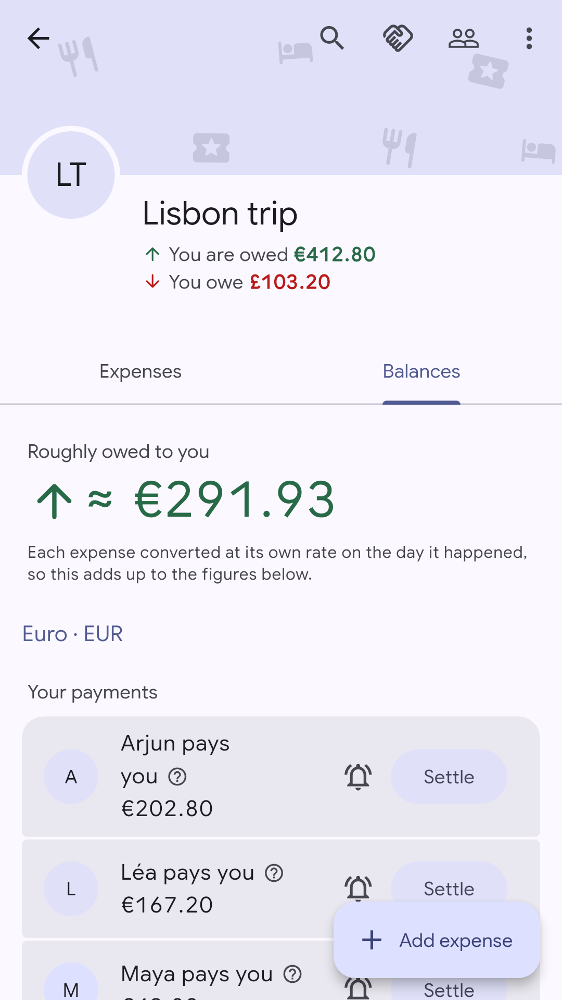

<h1 align="center">
  <picture>
    <source media="(prefers-color-scheme: dark)" srcset="assets/brand/mark-on-dark.svg">
    
  </picture>
   
  OpenSplit
</h1>

  Free, open-source expense splitting for Android and the web. 
  Your ledger works offline and shared groups sync when you reconnect.

<!-- Google Play badge artwork: https://play.google.com/intl/en_us/badges/static/images/badges/en_badge_web_generic.png -->

  
  

  

- Split expenses by amounts, percentages or weights.
- Keep exact balances per currency and see converted estimates when rates are available.
- Search your ledger on your device and export groups to CSV.

The app has no ads or premium tiers. See the [project principles](PRINCIPLES.md)
and [group lifecycle](docs/group-lifecycle.md).

  

## Get involved

- [Report a bug or request a feature](https://github.com/eigeninteractive/opensplit/issues/new/choose)
- [Report a security issue privately](SECURITY.md)
- [Contribute code or documentation](CONTRIBUTING.md)
- [Support OpenSplit](https://opensplit.eigeninteractive.com/support) and
  [see the people who help sustain it](https://opensplit.eigeninteractive.com/support#supporters).
  Voluntary contributions fund development, maintenance and hosting.

## Licence

[AGPL-3.0](LICENSE) · Copyright © 2026 EigenInteractive.
See the [brand guide](docs/brand/README.md#licensing-and-branding) for the name, artwork and font.
